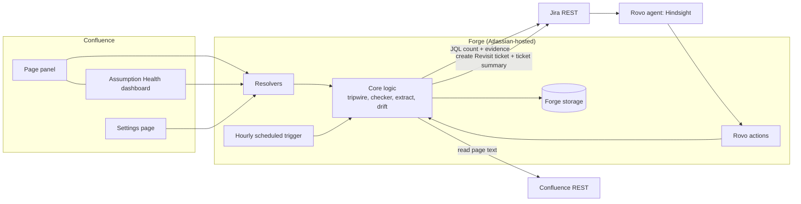

<div align="center">

# Hindsight

### Confluence design docs that watch Jira.

**Every assumption gets a tripwire. When reality contradicts the doc, Hindsight raises the flag, links the evidence and opens a "Revisit this assumption" ticket.**


[The problem](#the-problem) · [What it does](#what-it-does) · [Try it in 3 minutes](#try-it-in-3-minutes) · [How it works](#how-it-works) · [Permissions](#permissions-scopes-and-why) · [Limitations](#limitations-honest-list)

</div>

---

Design docs are full of assumptions: "checkout handles 1,000 orders a minute", "the vendor API never exceeds 200 ms".
Months later Jira fills with bugs that contradict those claims, but nothing connects the two. The doc stays confident
while reality has already moved on. Hindsight watches Jira for each assumption, raises the flag when reality
contradicts the doc, links the evidence, and opens one "Revisit assumption" ticket.

> Built on Atlassian Forge for **Atlassian Codegeist 2026**. Category: Apps for Software Teams. Bonus track: Rovo agents.

## Try it in 3 minutes

1. **Install** with the installation link (see [Set up](#set-up)). Install on **both Confluence and Jira**; you need site admin rights.
2. In Confluence open **Apps > Assumption Health** and click **Demo mode** (top right). About 15 seconds later you have a design doc, four Jira issues and four assumptions (one contradicted, two healthy, one unverified).
3. Open the demo page, click **Hindsight** under the title, and watch the contradicted assumption: its evidence issues, impact note, suggested owner and the "Revisit assumption" ticket.
4. Click **Turn off** to remove all demo data again.

<!-- Screenshots: save images in docs/screenshots/ and uncomment these lines.


-->

## Built with

| Layer | Technology |
|---|---|
| Platform | Atlassian Forge (UI Kit, `@forge/react`), runtime Node.js 24 |
| Modules | Confluence byline item, global page, settings page, hourly scheduled trigger, Rovo agent and actions |
| Data | Forge key-value storage (`@forge/kvs`) plus a small Jira issue property |
| APIs | Jira REST v3 (JQL count and search, issue create) and Confluence REST v2 |
| Tests | `node:test`, 94 unit tests for the core logic |

## The problem

- A design doc lives in Confluence. The bugs live in Jira. Nothing links a specific *claim* to the *evidence*.
- Docs go stale after implementation starts; teams find out late, often in a postmortem.
- Existing tools cover nearby needs (decision logs, risk registers, stale-page finders, Jira Automation), but we found
  none that starts from a specific claim in a doc, checks it against live Jira data, and flags only that claim.
  (We could not search every app, so we do not claim nobody has built this.)

## What it does

| Feature | Where |
|---|---|
| **Page panel**: list a page's assumptions with status, count, last check, ticket, and a plain-English impact note | "Hindsight" item under any Confluence page title, opens a large centered window |
| **Suggest assumptions** from the page text. You confirm each one before it is saved | Panel > Add assumption |
| **Tripwires**: a Jira query + a threshold + a window, built from templates or custom JQL, validated against Jira before saving | Panel > Add assumption |
| **Five statuses** from an evidence-confidence model: healthy, at risk, contradicted, unverified, stale. A keyword match is *related* evidence, never proof; a person confirms a contradiction | Panel, dashboard |
| **Check now** and an **hourly checker** (plain code, no AI) | Panel, Forge scheduled trigger |
| **One ticket per problem**: no duplicates while open; a new ticket if the old one was resolved and it trips again | Jira |
| **Impact note**: what the doc assumed, what Jira shows, which issues, suggested owner. Numbers always come from code | Panel |
| **Doc freshness**: has Jira work in the doc's area changed since the page was last edited? | Panel > Doc freshness |
| **Assumption Health dashboard**: tiles, filters, search, sort, links, audit log | Confluence > Apps |
| **Settings** (site admins): ticket project, default window/threshold, check interval, optional Confluence comment | Confluence admin > Apps > Hindsight |
| **Demo mode** (site admins): one click creates a design doc, Jira issues and assumptions; one click removes them | Top right of the dashboard |
| **Rovo agent "Hindsight"** in chat and as an agent on a Revisit ticket | Rovo |

## How it works



Key rule: **numbers come from code, wording and judgement from AI.** The scheduler never calls an AI. The Rovo agent only
reports counts and issue keys returned by Hindsight's actions, and saves nothing without a user's explicit yes.

## Set up

Requirements: an Atlassian Cloud site with **Jira and Confluence**, and site admin rights.

1. Open the installation link: `<INSTALL_LINK>` (shared from the Forge Developer Console).
2. Choose your site and install on **both Confluence and Jira** (the app needs both).
3. Optional, to see it working at once: open **Apps > Assumption Health** and click **Demo mode** (top right, site admins).
   In about 15 seconds you get a design doc, four Jira issues, and four assumptions linked to the release "Checkout v2.0"
   (one contradicted, two healthy, one unverified). Click **Turn off** to remove it all again.
4. Open the demo page, click **Hindsight** under the title, then **Open Hindsight**.
5. Optional: set the ticket project and defaults under **Confluence admin > Apps > Hindsight**.
6. Optional: for the Rovo agent, use a site where Rovo is enabled, then **Ask Rovo > agent picker > Hindsight**.

## Permissions (scopes) and why

| Scope | Why |
|---|---|
| `storage:app` | Save assumptions, settings and the audit log in Forge storage |
| `read:jira-work` | Count and search issues for tripwires; read ticket status |
| `write:jira-work` | Create the "Revisit assumption" ticket; sample-data issues; a small summary property on that ticket |
| `read:page:confluence` | Read a page's text and last-edited date to suggest assumptions and check freshness |
| `read:space:confluence`, `write:page:confluence`, `delete:page:confluence` | Sample data only: create and remove the demo page |
| `write:comment:confluence` | Optional footer comment when an assumption breaks (off by default) |

See [PRIVACY_AND_PERMISSIONS.md](PRIVACY_AND_PERMISSIONS.md) for what is stored and who can see what.

## Project layout

```
manifest.yml            Forge modules, scopes, Rovo agent and actions
src/frontend/           UI Kit screens: panel (index), dashboard, settings
src/resolvers/          Backend functions the screens call
src/actions/            Rovo agent actions
src/scheduler/          Hourly checker
src/lib/                Core logic: tripwire, checker, extract, drift, sample data, jira, confluence, storage, audit
test/                   Unit tests (npm test)
```

## Develop

```
npm install
npm test                      # unit tests (node:test)
forge lint
forge deploy -e development
forge install --upgrade -e development -s <site> -p Confluence   # and -p Jira
```

## Limitations (honest list)

- **A tripwire is only as good as its query.** Hindsight counts Jira issues; some assumptions (for example latency) cannot
  be measured by Jira bug counts. A person (or the Rovo agent, with confirmation) chooses the query.
- **Suggestions are drafts.** The built-in suggester uses fixed text rules (assumption wording and numbers with units) as a
  fallback that always works. The Rovo agent reads the page with real understanding. Either way a human confirms each one.
- **Forge storage is separate for the Jira and Confluence installations.** To let a Rovo session on a Jira ticket see an
  assumption, Hindsight also stores a small summary on the Revisit ticket (a Jira issue property).
- **The scheduler runs as the app**, so it only sees Jira projects the app user can browse. Reads shown to a person run as
  that person.
- **Rovo needs a site where Rovo is enabled** (Atlassian documents a verified business domain and a paid or trial plan).
  Everything else works without Rovo.
- **Not yet validated with working teams.** Our evidence is public sources, listed in DEVPOST.md.
